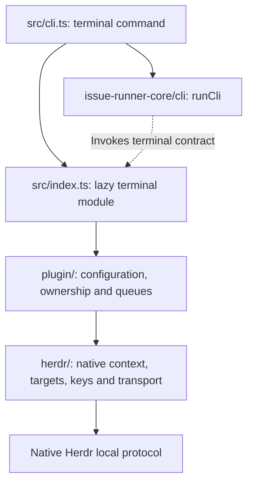

# Code architecture

This map assigns code and tests to their owners. Interface behavior lives in the [Core public integration contract](https://github.com/BuddyLabsCo/issue-runner-core/blob/main/docs/terminal-contract.md); native calls and interaction sequences live in the [Herdr protocol](herdr-protocol.md).

## Directory map

```text
/
|-- src/
|   |-- cli.ts                 # Executable; delegates command policy to Core
|   |-- index.ts               # Public contract version and factory assembly
|   |-- plugin/
|   |   |-- config.ts          # Unknown configuration boundary
|   |   `-- operations.ts      # Tab handles, bound I/O, queues and revocation
|   `-- herdr/
|       |-- targets.ts         # Host context, native identities and operations
|       |-- client.ts          # JSON-line transport, limits and invalidation
|       `-- keys.ts            # Logical chord validation and native encoding
|-- tests/
|   |-- unit/                  # Key validation and architecture quality rules
|   |-- integration/           # Public adapter behavior over protocol substitutes
|   |-- package/               # Installed exports, CLI and Core compatibility
|   |-- release/               # Release automation with Git and service substitutes
|   `-- fixtures/              # Scripted native protocol and package consumers
|-- scripts/release/           # Proposals, candidate checks and publication
|-- docs/                      # Reader documentation and separate agent instructions
|-- .github/workflows/         # Ubuntu/Windows checks and release automation
`-- dist/                      # Generated JavaScript and public declarations
```

## Dependency direction



Imports flow from the public terminal entry through `plugin/` to `herdr/`. Core supplies public types through `issue-runner-core/terminal`. Native code never imports the plugin layer, and runtime code never imports test fixtures or Core internals.

## Module ownership

| Owner | Responsibility |
| --- | --- |
| `src/cli.ts` | Supply command name, package version, lazy terminal module, real executing package root and CLI entry to Core's `runCli`. Core validates the installation, owns process/signals and discovers enhancements. |
| `src/index.ts` | Export only `contractVersion` and `createTerminalPlugin`; assemble validated configuration, host and operations. Importing this module invokes neither the CLI nor native initialization. |
| `plugin/config.ts` | Validate the unknown configuration boundary as an object. Shared field validation belongs to Core. |
| `plugin/operations.ts` | Keep handles and native associations inside one plugin instance. Capture submit keys and optional revocation signals at creation, bind I/O to the same target, and reject foreign or retired handles. |
| `plugin/operations.ts` input queue | Serialize command, text and key operations per tab. Reads bypass the queue; independent tabs can proceed concurrently. Check revocation after queue admission and target checks, immediately before input starts. Started input keeps its queue slot until completion or native error; later revoked work sends nothing. |
| `herdr/targets.ts` | Capture inherited host context, validate native workspace/tab/pane/terminal identities, apply cwd/environment rules, and implement targeted native creation, I/O and closure. Keep platform path and environment differences here. |
| `herdr/client.ts` and `herdr/keys.ts` | Encode native input and communicate over bounded JSON-line requests. Correlate replies, preserve backend errors, invalidate lost contexts and settle pending sockets without replay. |
| Core | Own CLI policy, workflows, enhancement discovery/lifecycle, preflight, monitoring, startup delays, readiness, session identity, Assignment notification, retries, handoff acceptance and recovery. |

Explicit closure remains available after revocation and targets only the owned native tab. It never invokes enhancement cleanup. Protocol loss invalidates the instance; target identity changes invalidate the handle. Native identity validation and mutation are separate requests, so the adapter cannot guarantee identity continuity across every server restart.

## Code placement rules

- Keep public exports and assembly in `src/index.ts`; keep the executable's Core integration in `src/cli.ts`.
- Put handle ownership, bound capabilities, input ordering and revocation in `plugin/`. Keep native identifiers private.
- Put native protocol, socket limits, key encoding, target validation and platform differences in `herdr/`. Native filesystem and transport access belong here.
- Leave shared workflow and Agent policy in Core. Herdr neither imports enhancements nor interprets `terminalPlugins.agentStartDelay` or `terminalPlugins.enhancements`.
- Keep helpers beside their owner. Add directories when needed, not as empty scaffolding.
- Keep release automation outside the runtime package. Reuse supplied-candidate checks and release service substitutes.

## Test placement rules

| Location | Coverage and boundary |
| --- | --- |
| `tests/unit/` | Logical chord mapping/rejection and executable lint rules for architecture boundaries. |
| `tests/integration/` | Real public factory, tab operations and bound I/O through `tests/fixtures/herdr.ts`. Cover host context, ownership, literal text, ordering, revocation, failures, closure and finite timeouts. Gate scripted replies to test races without exposing runtime seams. |
| `tests/fixtures/herdr.ts` | Private local-socket protocol substitute. Exercise actual JSON-line transport and script native results, identities, delays and failures; keep this seam out of public exports. |
| `tests/package/` and `tests/fixtures/package.ts` | Build or accept an unchanged candidate, install with its exact npm Core dependency, and verify public exports/declarations, inert imports and CLI identity in a relocated global prefix. |
| `tests/release/` | Exercise release entry points with disposable real Git repositories and substituted GitHub/npm services. These checks do not establish live publication. |

Protocol substitutes do not prove actual PTY delivery, Agent acceptance or complete workflow success.
