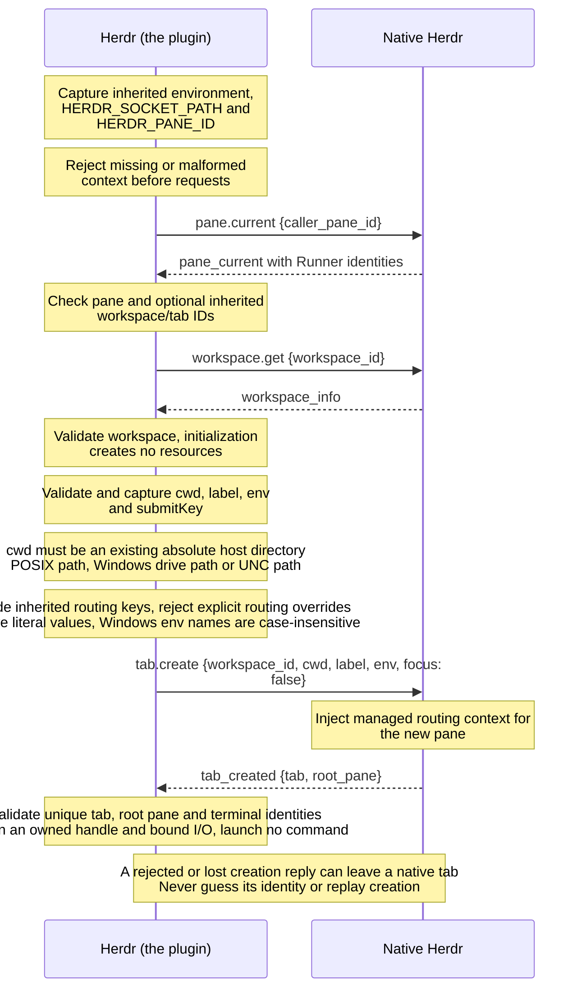
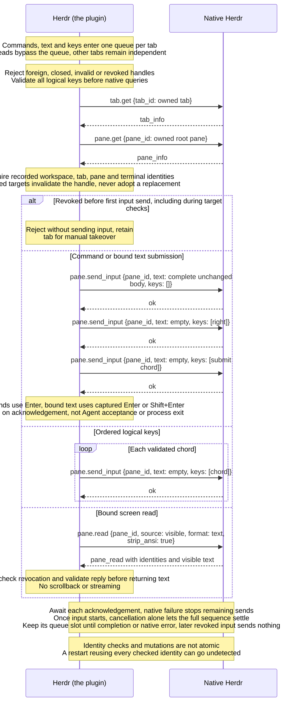
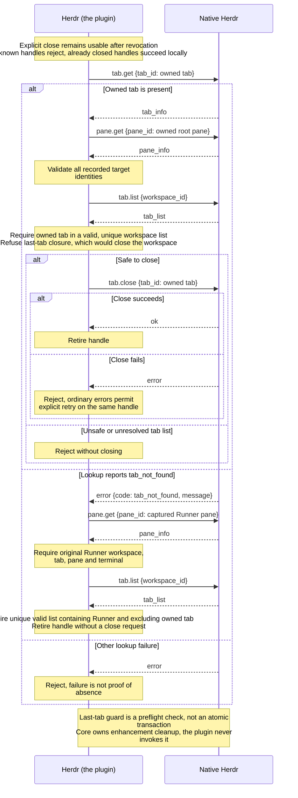
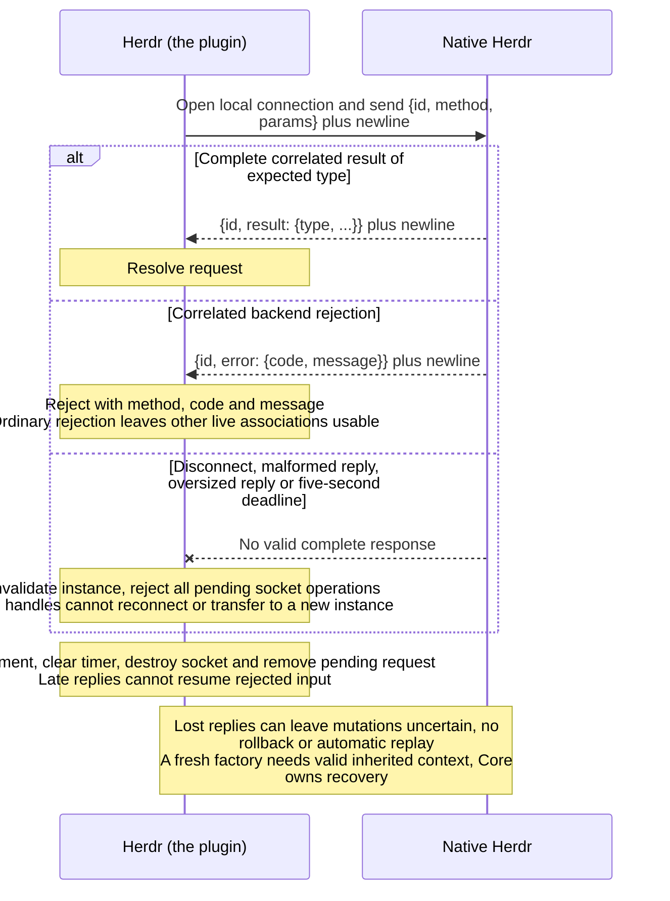

# Herdr protocol

## Native interfaces used

The adapter targets [Herdr 0.9.5](https://github.com/herdrdev/herdr/tree/2ecf19a92fc3a7fff75b6ce3655ef04f4625ec01). These interfaces describe current adapter behavior, not live-terminal acceptance results.

| Interface | Parameters used | Purpose |
| --- | --- | --- |
| `pane.current` | `caller_pane_id` | Resolve the inherited Runner pane and check optional inherited workspace/tab IDs |
| `workspace.get` | `workspace_id` | Validate the Runner workspace before creating resources |
| `tab.create` | `workspace_id`, `cwd`, `label`, `env`, `focus: false` | Create an interactive tab in the captured workspace and record its validated `tab` and `root_pane` identities |
| `tab.get` | `tab_id` | Validate the owned tab before I/O or closure |
| `pane.get` | `pane_id` | Validate the owned pane, or revalidate Runner when confirming an owned tab's absence |
| `pane.send_input` | `pane_id`, `text`, `keys` | Send a complete literal body or one encoded logical chord; native Herdr handles bracketed paste |
| `pane.read` | `pane_id`, `source: "visible"`, `format: "text"`, `strip_ansi: true` | Read the current visible screen and validate returned identities, source, format and text |
| `tab.list` | `workspace_id` | Guard against last-tab closure and confirm absence with an unambiguous workspace list |
| `tab.close` | `tab_id` | Close only the owned native tab; acknowledgement does not prove process or descendant exit |

[Local protocol requests](https://github.com/herdrdev/herdr/blob/2ecf19a92fc3a7fff75b6ce3655ef04f4625ec01/src/api/client.rs) use one connection per UTF-8 JSON line: `{id, method, params}`. Replies must correlate `id` and contain either `result: {type, ...}` or `error: {code, message}`. Each request has a total five-second deadline and a 1 MiB request/reply limit. Linux/macOS use the inherited Unix socket path. [Windows namespace mapping](https://docs.rs/interprocess/2.4.4/interprocess/local_socket/enum.GenericNamespaced.html) prepends `\\.\pipe\` to it. There is no TCP fallback or default-server discovery.

[Public native IDs](https://github.com/herdrdev/herdr/blob/2ecf19a92fc3a7fff75b6ce3655ef04f4625ec01/src/workspace.rs) use `123456789ABCDEFGHJKMNPQRSTVWXYZ0`, including multi-character suffixes. The adapter validates workspace prefixes and keeps workspace, tab, pane and terminal identities private. Labels and UI focus never select targets.

## Interaction sequences

### Initialize and create a tab

### Validate targets, submit input and read output

### Close an owned tab or confirm absence

### Settle requests and handle protocol loss

